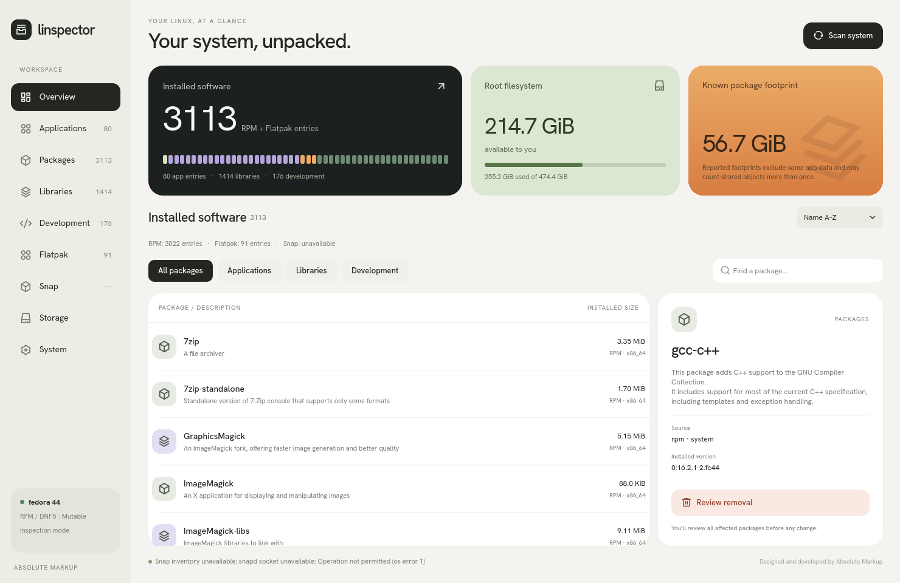

# Linspector

## Linux Package Inspector

**Explore the software behind your Linux desktop.** Linspector brings applications, command-line tools, libraries and development packages into one native interface, alongside storage usage and system details.

Designed and developed by **Absolute Markup**. Built with **Qt Quick/QML and Rust**.

**Early testing · Source builds · Linux**

[Start testing](docs/testing.md) · [Submit a testing report](https://github.com/absolute-markup/linspector/issues/new?template=testing-report.yml) · [Build guide](docs/development.md) · [Roadmap](docs/milestones.md)

## See more than applications

Your computer relies on more than the apps in its launcher. Linspector helps you see the packages that make everything work, understand their role and explore how they connect.

- **Your installed software.** Browse applications, libraries, development tools and system packages. Different architectures, versions, installation scopes and Flatpak branches stay distinct.
- **Details with context.** Inspect titles, descriptions, versions, sizes, licenses, maintainers, source packages and other metadata where the software source supplies them. Missing information stays unavailable.
- **Package relationships.** Explore requirements, provided capabilities and possible reverse dependencies. Results explain their limits; a dependency count is never presented as proof that removal is safe.
- **Storage at a glance.** See mounted filesystems, free space and the largest package footprints. Package estimates and filesystem usage have different meanings and are shown separately.
- **A view of your system.** Find distribution, username and account/session details, CPU, memory, hardware, graphics, drives, networking, battery and available platform information in the System tab.
- **Search and refresh.** Find software by name, description or source, then scan again when your system changes. Each software source has its own status so an unavailable source does not erase other results.

## How it works

1. **Open Linspector.** It detects your distribution and available software sources, then reads their installed inventories.
2. **Browse or search.** Select a package to read its description, metadata and relationships.
3. **Explore System and Storage.** See the wider picture of your machine and its space usage.
4. **Review supported changes.** Where available, inspect a removal plan or eligible service startup change before confirmation and authentication.

Ordinary inspection runs as your normal account. The application has no automatic inventory-upload feature. System details can contain personal information, so review screenshots and logs before sharing them.

## Current status

Linspector is **in early development and seeking testers**, not a finished package manager. The long-term goal is broad Linux distribution support; full compatibility is not yet established.

| System or source | Available today | Validation still needed |
| --- | --- | --- |
| **Fedora 44 / RPM** | Live package inspection and DNF removal previews; an authenticated helper and eligible systemd startup controls are implemented | Real authentication, removal, service changes and recovery in a disposable desktop VM |
| **Ubuntu / Debian** | Read-only dpkg inspection, metadata, ownership and dependency candidates | Full native desktop builds/startup; package data has passed comparisons against Ubuntu 24.04 and Debian 12/13 base-image databases |
| **Arch / pacman** | Read-only local ALPM package database inspection | Native Arch desktop and pacman comparisons; current support uses the default database path |
| **openSUSE / RPM + Zypper** | RPM inspection and a Zypper removal dry-run review adapter | Native desktop/preview validation; authenticated Zypper execution is not implemented |
| **Flatpak** | Read-only apps, runtimes, extensions, branches, scopes, commits and size estimates | Wider distribution/version coverage; live Fedora and isolated installation-scope checks have passed |
| **Snap** | Read-only installed revisions, states, bases and installed components | Real Snap daemon integration; current verification uses fixtures |

**Management is experimental.** Fedora changes require a separately installed helper and administrator authentication. Without that helper, changes remain unavailable. Perform package-changing tests only in a disposable VM with a restorable snapshot, following the [Fedora management test guide](docs/fedora-vm-testing.md).

Ubuntu/Debian, pacman, Flatpak and Snap inspection is currently read-only. This is the present implementation scope. Libraries and ordinary packages do not have a general “disable” switch; the implemented startup controls apply only to eligible package-owned services.

Repository origin and available updates are incomplete or unavailable. Reverse dependencies are candidates, not a complete solver-validated graph. Package footprints can include shared files and are not a promise of space recovered by removal. See the [verification record](docs/verification.md) for evidence and remaining limits.

## Try it and help shape it

We welcome **users and developers on Fedora, Ubuntu, Debian, Arch Linux and openSUSE**. Build/startup results, missing packages, metadata differences, usability feedback and code reviews all help.

Start with the [testing guide](docs/testing.md), use the current `main` source and record the commit you tested. Then [submit a testing report](https://github.com/absolute-markup/linspector/issues/new?template=testing-report.yml), including successful results. Build or startup failures are useful findings too.

There are **no current ready-to-install AppImage, RPM or Flatpak releases**. The historical `v0.1.0-starter` release predates the current integrations; use [the current source](https://github.com/absolute-markup/linspector/archive/refs/heads/main.zip) or clone the repository. Build instructions are in the [developer guide](docs/development.md) and [Ubuntu/Debian guide](docs/ubuntu-debian-testing.md).

## What comes next

Our next priorities are to:

- **Finish native validation.** Close the Ubuntu/Debian desktop, Fedora management and Arch/Snap/openSUSE testing gaps, then fix and retest reported problems.
- **Extend reviewed management.** Implement transaction-bound openSUSE execution and develop additional management capabilities with explicit review and validation for each provider.
- **Support more Linux systems.** Add dedicated workflows for immutable, transactional and declarative distributions, followed by additional distribution families.
- **Improve everyday use.** Refine the interface, accessibility, keyboard navigation, display scaling and performance on large inventories.
- **Make installation easier.** Prepare clean-install checks, a compatibility matrix and AppImage/RPM packaging, then pursue Flatpak marketplace distribution once its permissions and host integration are resolved.

These are development goals, not released features or delivery dates. Follow the [milestone roadmap](docs/milestones.md) for scope and progress.

## For developers and reviewers

Linspector uses native **Qt Quick/QML + Rust + CXX-Qt**, with provider-specific inventory readers and explicit capability checks. See the [developer guide](docs/development.md), [distribution architecture](docs/distribution-support.md), [management boundary](docs/management-validation.md) and [contribution guide](CONTRIBUTING.md).

Source is published for inspection and testing. Copyright remains with Absolute Markup; **an open-source license has not been selected**. See [COPYRIGHT](COPYRIGHT). Third-party dependencies and bundled fonts/icons retain their own licenses.

---

**Linspector** — LINux + inSPECTOR

Designed and developed by **Absolute Markup**.

Developed by a human at Absolute Markup, with Codex assisting with implementation and testing.
